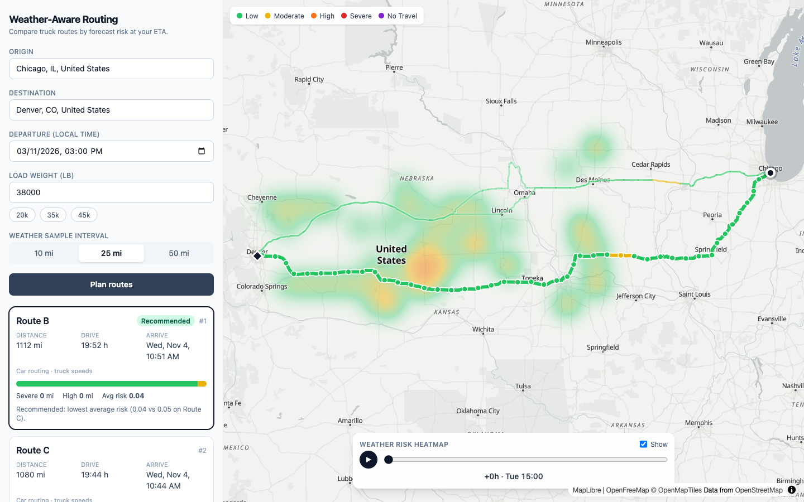
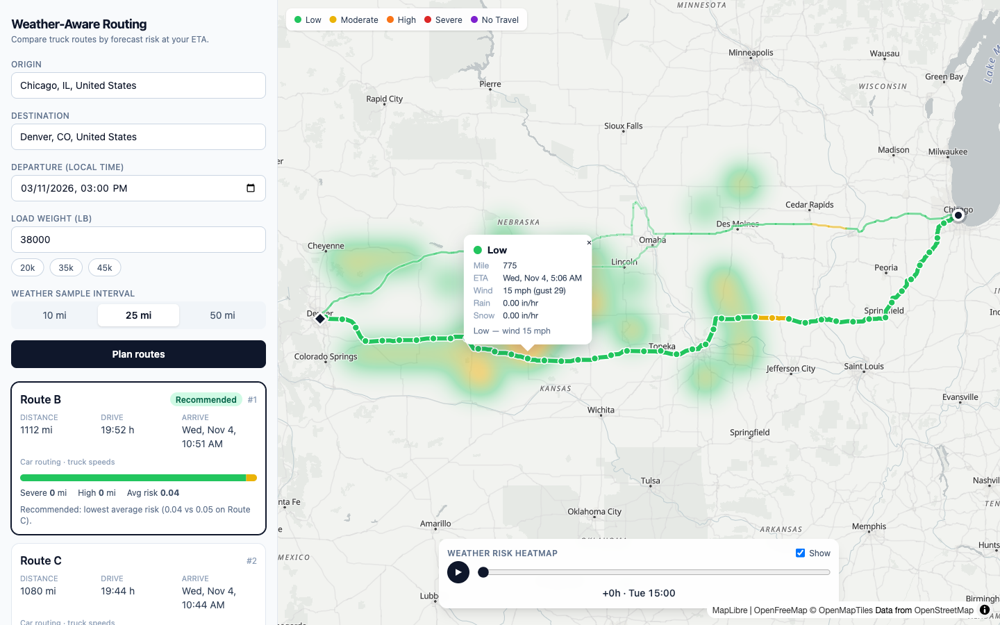
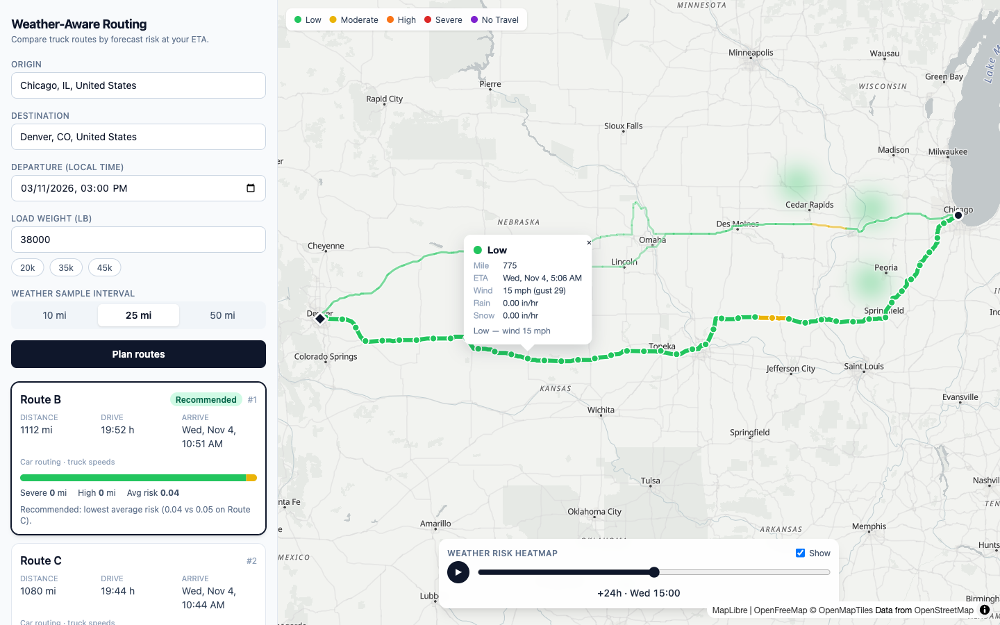
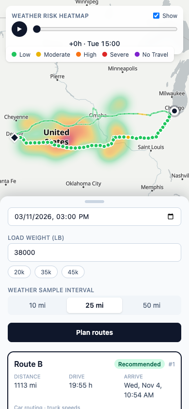
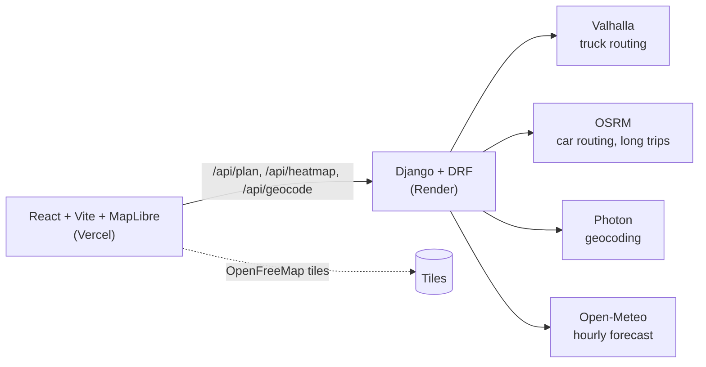

# Weather-Aware Truck Routing

Pick a trip, a departure time and a load weight. The app returns three routes, samples the forecast at the truck's own ETA at every checkpoint, scores the risk with the brief's rules, and recommends one route with a plain-English reason. A 0-48 h heatmap slider shows how the weather moves along the corridor.

**Live demo:** https://weather-truck-routing-five.vercel.app  ·  **API:** https://weather-truck-routing-api.onrender.com/api/health
**Loom walkthrough:** <TBD>



## Features vs. the brief

| Requirement | How it is implemented |
|---|---|
| Origin, destination, departure, load | Trip form with Photon autosuggest (`/api/geocode`), datetime (limited to now..+7 d), load in lb |
| 3 route options | Valhalla truck routing: native alternates, topped up with perpendicular via-point detours; OSRM fills or replaces it on long trips. Deduplicated, always up to 3 |
| Weather every 10 / 25 / 50 mi at the truck's ETA | Checkpoints by haversine distance along the geometry; ETA interpolated from per-maneuver durations; Open-Meteo hour bucket for that ETA |
| Risk with the provided rules | `routing/domain/risk.py`, pure functions, boundary-tested |
| Recommend the best route | `routing/domain/scoring.py`: lexicographic key (see below) plus a generated reason |
| Routes, checkpoints, risk, ETAs, summaries on a map | MapLibre: segments coloured by risk, checkpoint popups with ETA/weather/driver, route cards with miles-by-level bar |
| Heatmap with 0-48 h slider | GPU heatmap layer, one feature per grid point with `h0..h48` properties, play/pause, truck marker |

| Checkpoint popup | Heatmap slider | Mobile |
|---|---|---|
|  |  |  |

## Architecture



Request flow for `POST /api/plan`:

1. Validate input (interval 10/25/50, load 0-80,000 lb, departure within now-1 h..+7 d, distinct endpoints).
2. `router.get_routes`: Valhalla truck (<= 1,400 km straight line) or OSRM beyond that; up to 3 deduplicated routes with total duration and maneuver timings.
3. On the **full-resolution** geometry: place checkpoints every N miles plus the destination, and compute each checkpoint's ETA.
4. Snap checkpoints to a 0.1 degree grid and batch-fetch hourly forecasts from Open-Meteo (concurrent, cached 30 min per cell).
5. Look up the weather for each ETA and run `risk.assess` (thresholds + load rules) per checkpoint.
6. `scoring.summarize` (miles per level, average risk) and `rank_routes` (ordering + reason text).
7. Simplify the output geometry (Douglas-Peucker, about 50 m), round to 5 decimals, return JSON (gzipped on the wire). The frontend then calls `/api/heatmap` separately so routes render first.

Full request/response shapes: [`docs/API_CONTRACT.md`](docs/API_CONTRACT.md). Original plan: [`docs/PLAN.md`](docs/PLAN.md).

## Risk and recommendation logic

Levels: 0 Low, 1 Moderate, 2 High, 3 Severe, 4 No Travel.

| Condition | Low | Moderate | High | Severe | No Travel |
|---|---|---|---|---|---|
| Wind (mph) | < 25 | 25-<35 | 35-<45 | 45-<55 | >= 55 |
| Rain (in/hr) | < 0.10 | 0.10-<0.25 | 0.25-<0.50 | 0.50-1.00 | > 1.00 |
| Snow (in/hr) | < 0.5 | 0.5-<1.0 | 1.0-<2.0 | 2.0-3.0 | > 3.0 |

- **Load rules** (applied to the wind level): 45-54 mph and load > 30,000 lb gives No Travel; 35-44 mph and load > 40,000 lb gives at least Severe. Wind >= 55 is No Travel for any load. "Load" here is the cargo weight the user enters (the tare is only used for routing, see below).
- **Checkpoint level** = max(wind level after load rule, rain level, snow level). The reported `driver` is the condition that set it (`load` when the load rule escalated it).
- **Segment level** = max of the levels of its two endpoint checkpoints. Segment miles are summed per level into `miles_by_level`.
- **Average risk** = sum(segment level x segment miles) / total miles.
- **Ranking key** (ascending): `(has_no_travel, severe_mi, high_mi, avg_risk, duration_s)`. This is the brief's order (fewest Severe, fewest High, lowest average, shortest time).
- **No Travel**: the brief does not say how to rank it. Any route with a No Travel checkpoint is treated as disqualifying and ranks behind every route without one, so it is the first key. If every route has No Travel, all are still ranked by the remaining keys, `all_no_travel` is set, and the reason text suggests delaying departure.

## Assumptions and trade-offs

- **Truck weight for routing:** Valhalla truck costing gets `load + 35,000 lb` tare, converted to tonnes. Risk rules use the entered load only.
- **Wind:** sustained `wind_speed_10m` is scored; gusts are displayed but not scored. Gusts would make results more conservative.
- **Hour buckets:** Open-Meteo precipitation is a total for the *preceding* hour, wind is an instantaneous value at the stamp. Wind uses the nearest hourly stamp to the ETA; rain/snow use the bucket that ends at or just after the ETA. The heatmap series is aligned the same way.
- **Public Valhalla limit:** the public server rejects trips over about 1,500 km. Beyond 1,400 km straight line the app uses OSRM car routing with segment speeds capped at 62 mph, so ETAs are truck-realistic but truck restrictions (height, hazmat, etc.) are not applied. Each route carries an `engine` field and the UI shows an engine badge. Routes in one response can mix engines.
- **No live traffic:** ETA is free-flow time plus nothing else. No time-dependent routing, no rest breaks or hours-of-service.
- **3 routes:** Valhalla native alternates first; if fewer than 3 distinct routes come back, perpendicular via-point detours (about 10% / 20% of trip length, both sides) are added, then OSRM alternates. Fewer than 3 are returned when the road network offers no distinct option.
- **Forecast horizon:** Open-Meteo is requested for 16 days, but departure is limited to 7 days ahead so the trip and the 48 h heatmap stay inside reliable hourly data. Trips longer than the forecast window clamp to the last available hour.
- **Heatmap is pure weather:** no load rules, so one colour field maps to one slider position regardless of the trip. Grid is points every about 15 mi along all routes with perpendicular offsets of 0, +-20, +-40 mi, capped at 600 points.
- **Caching:** Django locmem cache, 30 min per 0.1 degree weather cell. Per-process, so it is lost on restart and not shared between gunicorn workers.
- **Public fair-use servers:** Valhalla (openstreetmap.de), OSRM demo, Photon and Open-Meteo are free and rate limited. A production deployment would self-host Valhalla or use HERE / OpenRouteService with a key, and a paid weather tier.

## Performance

- **Heatmap slider** is GPU-only. Every grid point carries `h0..h48` properties; scrubbing calls `map.setPaintProperty('heat', 'heatmap-weight', ['get', 'h<N>'])` from [`MapEffects.tsx`](frontend/src/components/MapEffects.tsx) via a tiny external time store, so React does not re-render and there is **0 network** while scrubbing. Measured **p95 18.5 ms/frame over 578 frames**.
- MapLibre (about 1 MB) is **lazy-loaded** as its own chunk; the form and shell paint first.
- GeoJSON sources are **memoized** per plan; route selection restyles instead of rebuilding data.
- Checkpoints are a **circle layer**, not DOM markers.
- **Payload:** `/api/plan` for Chicago to Denver was 1.5-2.3 MB. Geometry is now simplified (Douglas-Peucker, 0.0005 degrees about 50 m) after risk and ETA are computed on the full geometry, coordinates are rounded to 5 decimals, and `GZipMiddleware` is on: **125 KB raw, about 25 KB gzipped** (3 routes, 25 mi interval).

## Local setup

No API keys are needed. Prerequisites: Python 3.11+, [uv](https://docs.astral.sh/uv/), Node 20, pnpm.

```bash
# backend  (http://localhost:8000)
cd backend
cp .env.example .env
uv sync
uv run python manage.py runserver

# frontend  (http://localhost:5173)
cd frontend
cp .env.example .env
pnpm install
pnpm dev
```

UI-only demo without a backend: set `VITE_USE_MOCKS=true` in `frontend/.env` (fixtures in `src/mocks`).

### Environment variables

| Side | Variable | Default | Purpose |
|---|---|---|---|
| Backend | `SECRET_KEY` | dev placeholder | Django secret key (set in production) |
| Backend | `DEBUG` | `0` (`1` in `.env.example`) | Django debug |
| Backend | `ALLOWED_HOSTS` | `localhost,127.0.0.1,.onrender.com` | Comma-separated hosts |
| Backend | `CORS_ALLOWED_ORIGINS` | `http://localhost:5173` | Frontend origin(s) |
| Backend | `VALHALLA_URL` | `https://valhalla1.openstreetmap.de` | Truck routing |
| Backend | `OSRM_URL` | `https://router.project-osrm.org` | Long-trip / fill routing |
| Backend | `PHOTON_URL` | `https://photon.komoot.io` | Geocoding |
| Frontend | `VITE_API_URL` | `http://localhost:8000` | Backend base URL |
| Frontend | `VITE_USE_MOCKS` | `false` | Serve fixtures instead of calling the API |

### Tests and checks

```bash
cd backend  && uv run ruff check . && uv run pytest -q    # 146 tests, upstream HTTP mocked with respx
cd frontend && pnpm lint && pnpm test && pnpm build      # 11 tests
```

CI runs the same commands: [`.github/workflows/ci.yml`](.github/workflows/ci.yml).

## Project structure

```
backend/
  config/                 settings (env-driven), urls
  routing/
    domain/               pure logic: risk, scoring, sampling, simplify, heatmap
    services/             Valhalla, OSRM, Photon, Open-Meteo clients; router (hybrid); planner
    api/                  DRF views, serializers, urls
    tests/
frontend/
  src/components/         TripForm, RouteCards, MapView, MapEffects, TimeSlider, Legend
  src/lib/                api, types, geojson builders, risk colors, time store
  src/mocks/              fixtures for mock mode
docs/                     API_CONTRACT.md, PLAN.md, LOOM_SCRIPT.md, screenshots/
```

## Deployment

- **Backend (Render, free plan):** `render.yaml` blueprint, root `backend/`; build `uv sync --frozen --no-dev` + `collectstatic`, start gunicorn, health check `/api/health`. Env: `SECRET_KEY` (generated), `DEBUG=0`, `ALLOWED_HOSTS=.onrender.com`, `CORS_ALLOWED_ORIGINS` (the Vercel URL). `VALHALLA_URL`, `OSRM_URL`, `PHOTON_URL` are optional overrides. The free plan sleeps after 15 min idle, so `.github/workflows/keep-warm.yml` pings `/api/health` every 10 min, and the frontend fires a warm-up request on page load.
- **Frontend (Vercel):** root directory `frontend/`, build `pnpm build`, output `dist`; `vercel.json` rewrites to the SPA. Set `VITE_API_URL` to the Render URL (build-time variable).

Time spent: <TBD>
